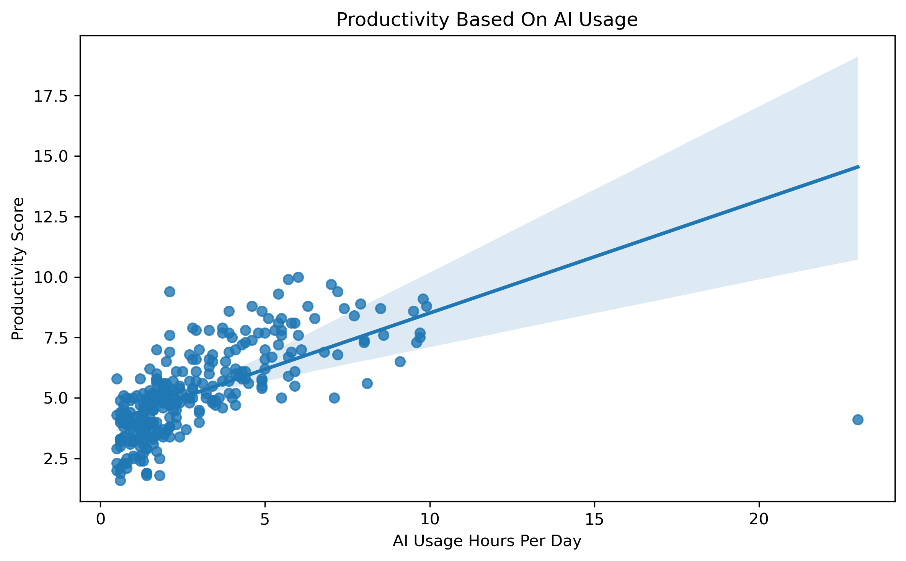
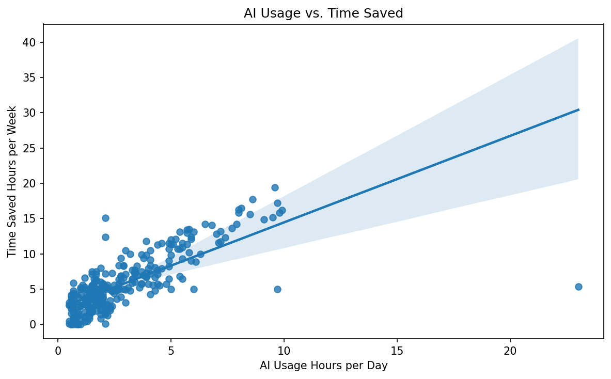
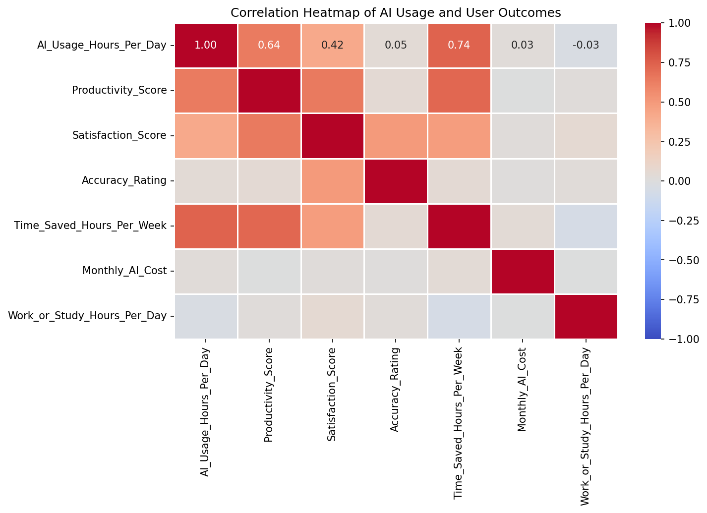

# AI Usage, Productivity & Satisfaction Analysis

### Exploring the Relationship Between AI Usage, Productivity, Time Savings, and User Satisfaction

## About the Project

How is daily AI usage related to productivity, time savings, and user satisfaction?

This project explores AI usage patterns among students and professionals through data cleaning, exploratory data analysis (EDA), statistical analysis, and data visualization using Python.

The goal is to investigate relationships between AI usage and reported outcomes, identify patterns in the dataset, and communicate findings through clear visualizations.

## Project Objectives

* Analyze daily AI usage patterns.
* Explore the relationship between AI usage and productivity.
* Investigate the relationship between AI usage and time saved.
* Examine the relationship between AI usage and user satisfaction.
* Study correlations among numerical variables.
* Present findings through meaningful visualizations.

## Tools and Technologies

* **Python** — Core programming language
* **Pandas** — Data cleaning and manipulation
* **NumPy** — Numerical operations
* **Matplotlib** — Data visualization
* **Seaborn** — Statistical visualization
* **Jupyter Notebook** — Analysis and documentation

## Dataset

The dataset contains information about AI usage among students and professionals, including usage duration, AI tools, purposes of use, productivity scores, time saved, and satisfaction scores.

* **Initial dataset size:** 300 rows and 19 columns
* **Dataset after duplicate removal:** 288 rows and 19 columns

**Data source:** [Kaggle dataset](https://www.kaggle.com/)

*Note: Replace the general Kaggle link above with the exact dataset page URL if you have it.*

## Project Workflow

1. Imported the dataset using Pandas.
2. Inspected the dataset structure and data types.
3. Checked for missing values and duplicate records.
4. Cleaned and prepared the data for analysis.
5. Performed exploratory data analysis.
6. Examined relationships between AI usage and other variables.
7. Created visualizations using Matplotlib and Seaborn.
8. Interpreted the results and documented key observations.

## Visualizations

### 1. AI Usage vs. Productivity

This visualization explores the relationship between daily AI usage hours and reported productivity scores.



### 2. AI Usage vs. Time Saved

This visualization examines how daily AI usage relates to reported time saved per week.



### 3. Correlation Heatmap

The correlation heatmap summarizes relationships among numerical variables in the dataset.



## Key Findings

The analysis identified the following patterns in the dataset:

* **AI usage and productivity:** A positive correlation of approximately **0.637** was observed.
* **AI usage and time saved:** The analysis reported a positive correlation of approximately **0.739**.
* **AI usage and satisfaction:** The analysis reported a positive correlation of approximately **0.419**.
* **Average daily AI usage:** Approximately **2.92 hours**.
* **Average satisfaction score:** Approximately **6.13**.
* **Recommendation rate:** Approximately **60.76%** of respondents would recommend AI tools.

*These figures should be verified against the final cleaned dataset and notebook outputs before publication. Correlation indicates an association, not causation.*

## Skills Demonstrated

* Data cleaning and preprocessing
* Exploratory data analysis (EDA)
* Missing-value and duplicate handling
* Statistical correlation analysis
* Data visualization
* Python programming
* Communicating data-driven insights

## Project Structure

```text
ai-usage-data-analysis/
│
├── Python_Project_Analysis.ipynb
├── README.md
├── ai_usage_vs_productivity.png
├── ai_usage_vs_time_saved.png
└── ai_usage_correlation_heatmap.png
```

## Conclusion

This project explores how AI usage relates to productivity, time savings, and user satisfaction within the available dataset.

The visualizations help communicate the observed patterns and demonstrate practical skills in Python-based data analysis. Further investigation with additional data would be needed to understand whether these relationships generalize beyond this dataset.

## Author

**Kanika Karosiya**

Aspiring Data Analyst | Python | Pandas | NumPy | Data Visualization
